# Adaptive Consistency Layer for MongoDB — Final Report

> NoSQL Databases (BCSE406L), VIT — DA team project.
> Branch `feature/adaptive-signals-lite` (base `main` @ `d9f7baf`). Evaluation run
> `FULL_2026-10-19_1452`: 19 Oct 2026, 14:52 → 19:21 (4 h 28 min), 90 load-test runs, 0 failed
> requests. Data and figures: [`results/signals/FULL_2026-10-19_1452/`](results/signals/FULL_2026-10-19_1452/).

---

## Summary

The adaptive layer on `main` chooses MongoDB's consistency settings (write concern, read concern,
read preference) per collection from **one number: the share of writes** in the last 15 seconds.
We added eight small, opt-in pieces. They let it handle situations that one number cannot:
- the client being close to one replica and far from the primary;
- a user reading back what they just wrote;
- majority writes that are too slow;
- collections with different importance.

They also make the switching steadier and explainable, and the evaluation fairer.

In a 4.5-hour evaluation (3 network setups × 5 configurations × 6 workloads, 180 s each):

| Finding | Number |
|---|---|
| Far primary (T1), read-heavy: reads stay local **and** own-write reads are never stale | read median **3 ms**, **0 / 824** stale probes. Traffic-only layer: 2 ms, **230 / 934 (24.6%)** stale. Fixed FAST: 34.5% stale. Fixed MODERATE: 0% stale but **88 ms** reads |
| Same, with bursty writes (SPIKE) | **0 / 572** stale vs **57 / 523 (10.9%)** for the traffic-only layer |
| Far primary, balanced writes: the latency budget leaves SAFE | write median **89 ms** vs **240 ms** for the traffic-only layer and fixed SAFE; throughput 249 vs 228 req/s. *Bought with weaker durability (w=1), by design* |
| Where SAFE is cheap (T2, equal distances), the budget stays out of the way | SAFE kept 97% of the time; SAFE write p95 40–48 ms |
| Hysteresis keeps a setting on a borderline workload (live check C5) | at 37.5% writes after SAFE: traffic rule alone → MODERATE; with hysteresis → stays SAFE (2 switches vs 1) |
| Policy floor overrides everything (live check C3) | 5%-write traffic on `floor="SAFE"` stays SAFE |
| Integrity of the run | 90/90 runs, 0 failed requests, no hung or retried run, 5/5 live checks, **8/8 pre-stated expectations held** |

What it does **not** do (Section 9): it has no guard against a lagging or failed secondary, and on equal
distances it still picks FAST, where FAST gains nothing. The 0% stale figure applies to a client's
**own** writes; reads of other clients' fresh writes under FAST are as stale as before.

---

## Contents

1. [The problem](#1-the-problem)
2. [The journey: how we got to these eight additions](#2-the-journey-how-we-got-to-these-eight-additions)
3. [System architecture (diagrams)](#3-system-architecture)
4. [The additions: why, how, and justification](#4-the-additions-why-how-and-justification)
5. [Engineering problems found and fixed on the way](#5-engineering-problems-found-and-fixed-on-the-way)
6. [Evaluation method](#6-evaluation-method)
7. [Results](#7-results)
8. [Analysis](#8-analysis)
9. [Limitations and threats to validity](#9-limitations-and-threats-to-validity)
10. [Reproducing everything](#10-reproducing-everything)
11. [Conclusion](#11-conclusion)
**Diagrams:** original layer (§3.1) · deployment (§3.2) · components (§3.3) · decision pipeline (§3.4) ·
state machine (§3.5) · write/read and feedback-tick sequences (§3.6) · network setups and link shaping
(§6.1) · one load-test run (§6.1) · evaluation pipeline (§6.7) · file interactions (§3.8) · every file (§3.9)

- [Appendix A: every load-test result](#appendix-a-every-load-test-result)
- [Appendix B: equal 5 ms data (earlier code version)](#appendix-b-equal-5-ms-data-earlier-code-version)
- [Appendix C: files and tests](#appendix-c-files-and-tests)

---

## 1. The problem

Every MongoDB read and write carries three knobs:

| Knob | Safe end | Fast end |
|---|---|---|
| **Write concern** `w` | `"majority"`: a majority of nodes must confirm | `1`: the primary alone confirms |
| **Read concern** | `"majority"`: only data a majority has | `"local"`: whatever the node has |
| **Read preference** | `primary` | `nearest`: the fastest-answering node, possibly a secondary |

Safety costs latency; speed costs **staleness** (a read from a secondary that has not received a
recent write yet). Applications usually fix these once, by hand, for everything. Workloads change,
though: the same collection is write-heavy during an import and read-heavy afterwards. So any
fixed choice is wrong part of the time.

The project's middleware observes each collection's traffic and switches between three named
configurations automatically:

| Name | Write concern | Read concern | Read preference | Meant for |
|---|---|---|---|---|
| **SAFE** | `majority` | `majority` | `primary` | write-heavy collections |
| **MODERATE** | `1` | `local` | `primaryPreferred` | in between; the default |
| **FAST** | `1` | `local` | `nearest` | read-heavy collections |

---

## 2. The journey: how we got to these eight additions

**1. The original layer (`main`).** A monitor counts reads and writes per collection in a sliding
window. A pure decision function picks SAFE / FAST / MODERATE. A feedback loop applies the choice on
a timer, with a cooldown against flapping. The benchmark runs it with a 15 s window, a 5 s tick and a
10 s cooldown (`benchmark/locustfile.py`).

**2. First evaluation: the rule was the problem.** The first decision rule used an *absolute* write
rate (more than 5 writes/s = "hot"). The first evaluation (24 Sep; 5 latency levels × 8 workloads ×
3 configurations; still on disk in `results/latency_*ms/`) ran ~250 ops/s, so every workload wrote at
least 12 writes/s, above the threshold. Adaptive therefore behaved like fixed SAFE: at 43 ms its write
medians were 130–160 ms against fixed SAFE's 130–170 ms (fixed FAST: 14 ms). We replaced it with the
**write share** (writes / all operations: above 0.40 → SAFE, below 0.15 → FAST), which gives the
same decision for the same traffic mix at any rate. The thresholds were fixed *before* the re-run
and not tuned to its results. *Sources: commit `35c1447` and the docstring of
`adaptive_layer/decision.py`; the old result files.*

**3. Second finding: the test bed could not show FAST's purpose.** Every node sat on one machine,
equally far from the client. FAST's `nearest` reads were therefore no faster than reading from the
primary. At 43 ms between nodes, fixed MODERATE (`w=1`, primary reads) matched FAST's latency
(write 1.5 / read 1.4 ms vs 1.5 / 1.3 ms) with **0 / 60** stale reads, against **42 / 60** for FAST
(72.5% in a second check). In that test bed, FAST could only lose. *Source: `plan/next_level_plan.md`
on `feature/next-level`, §1 and N1.*

**4. A first, large extension (`feature/next-level`), set aside.** It added a client-side network
topology, session-based read-your-writes, an SLO-driven controller and faster workload sensing
(phases N0–N4, committed 17–18 Oct), with an evaluation first budgeted at 28.4 h and later cut to
about 9.8 h. *Source: `plan/next_level_plan.md` on that branch.* The teammates judged it too big. They asked for **simple additions on
`main`** that go beyond "the traffic ratio picks the setting", and liked one idea in particular:
*nodes that are not all the same distance away*.

**5. Twelve small proposals, all implemented and tested.** Each came with a complexity rating
(1–10). All twelve were built on `feature/adaptive-signals` and checked live (Section 5 covers what
this found). An overnight 10-hour run then hung after 97 of 200 runs (Section 5.2).

**6. The team picked eight.** Kept: #1 unequal distances, #5 per-collection policy,
#6 read-your-own-writes per key, #8 hysteresis, #9 SAFE latency budget, #10 switch reasons,
#11 MODERATE baseline, #12 pinned primary. Not kept: #2 round-trip check, #3 replication-lag guard,
#4 node-health fall-back, #7 hot-key rule. These are preserved in `git stash`. The eight were
rebuilt on a fresh branch from `main`, `feature/adaptive-signals-lite`, with the hang fixed.

**7. Sizing the final run.** The 43 ms equal-delay level was dropped: T1 already has an 86 ms
(= 2 × 43 ms) round trip between nodes. The 5 ms level was dropped after checking the overnight data
(Appendix B): with these additions the layer behaves at 5 ms as at 0 ms. The workloads were cut
from 10 to the 6 that each exercise an addition (Section 6.3). The evaluation went from ~10 h to
~4.5 h with no loss in per-run quality.

---

## 3. System architecture

The diagrams below are drawn from the code on this branch (`adaptive_layer/`, `benchmark/`), not from
the plan. They use Mermaid, which GitHub and VS Code's Markdown preview render directly; a plain
text summary follows each one.

### 3.1 The original layer (`main`)

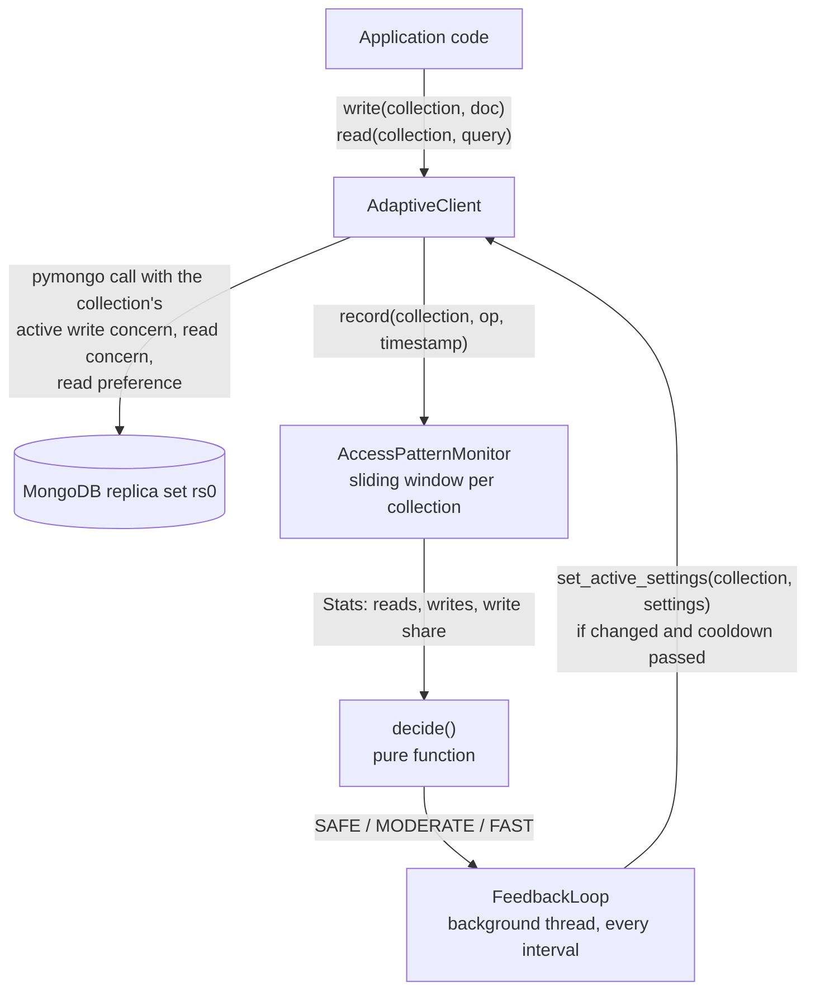

The application never passes consistency settings. `AdaptiveClient.write()`/`read()` look up the
collection's active settings, so the feedback loop changes behaviour without any caller change.
The decision rule on `main` (`adaptive_layer/decision.py`):

```python
def decide(stats, thresholds=DEFAULT_THRESHOLDS):
    if stats.read_count + stats.write_count == 0:
        return MODERATE_SETTINGS                  # no evidence either way
    if stats.write_share > thresholds.high_write_share:   # 0.40
        return SAFE_SETTINGS
    if stats.write_share < thresholds.low_write_share:    # 0.15
        return FAST_SETTINGS
    return MODERATE_SETTINGS
```

### 3.2 System context and deployment (test bed)

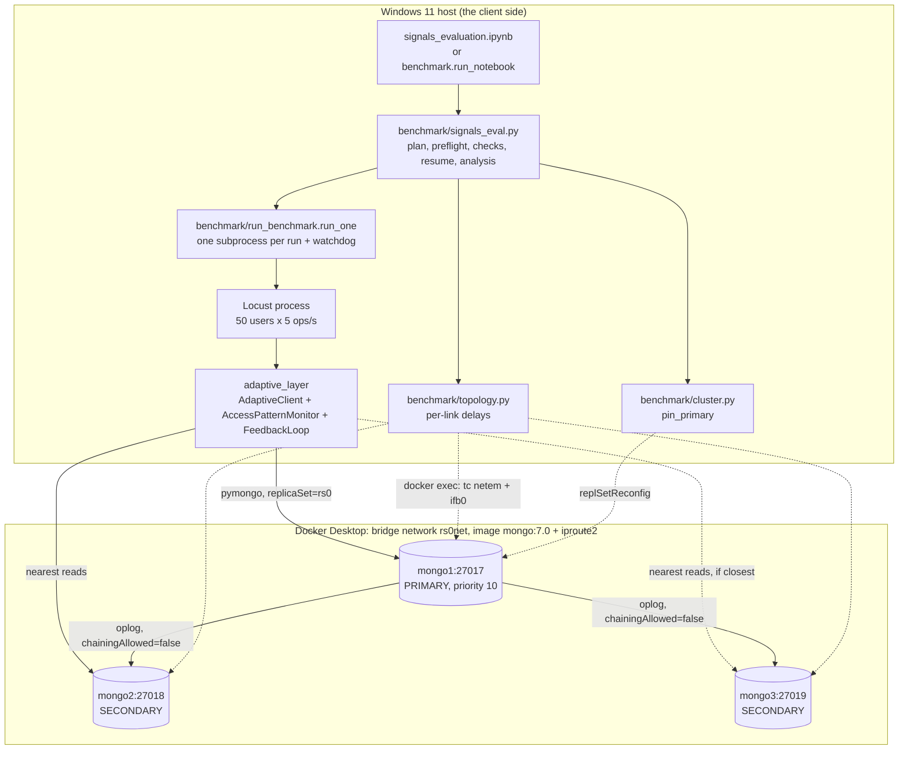

The client runs on the host. The three MongoDB nodes run in containers with the `NET_ADMIN`
capability, so `topology.py` can shape each node's links with `tc` (#1). `cluster.py` pins mongo1
as primary and turns chained replication off (#12), so both secondaries copy straight from it.

### 3.3 Components after the additions

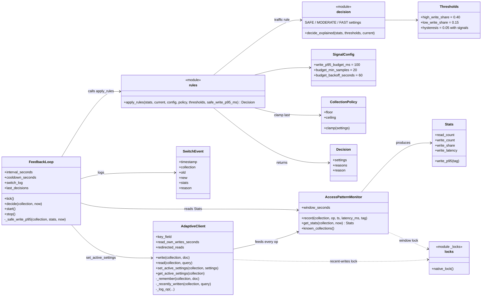

New on this branch: `rules.py` (`apply_rules`, `SignalConfig`, `CollectionPolicy`, `Decision`),
`_locks.py`, the `hysteresis` field, `decide_explained`, latency per settings name in the monitor,
the recent-writes memory in the client, and `reason` / `last_decisions` in the loop.

### 3.4 The decision pipeline (one collection, one tick)

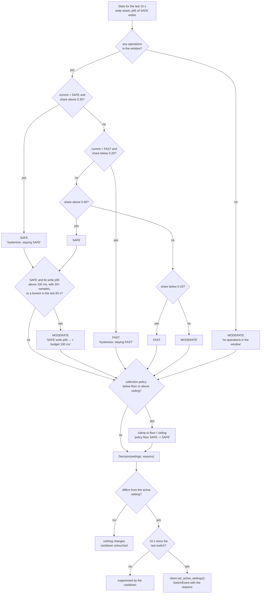

Every branch that is taken adds a reason; the joined reasons are what the switch log records (#10).
The budget only acts on SAFE, and the policy (#5) is always applied last.

### 3.5 The three settings as a state machine (with hysteresis and the budget)

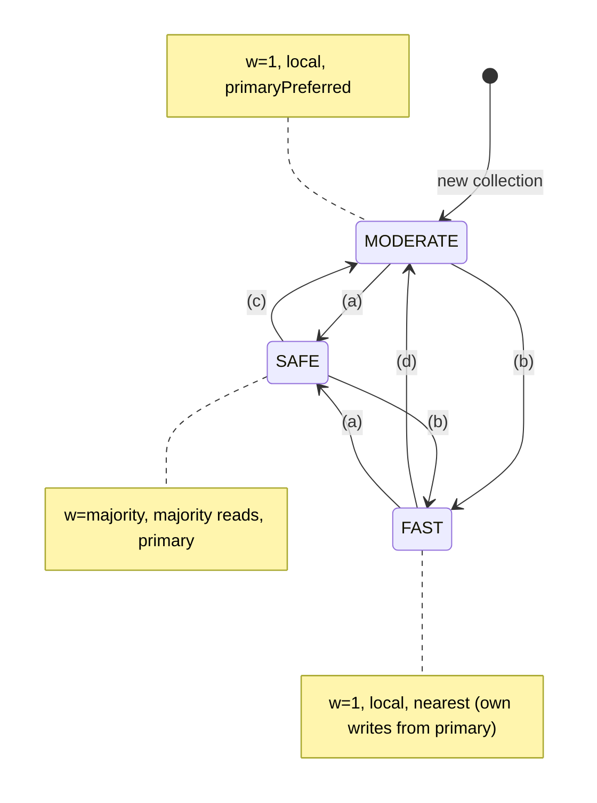

| Label | Condition (write share of the last 15 s) |
|---|---|
| (a) | above 0.40 |
| (b) | below 0.15 |
| (c) | 0.35 or less (hysteresis), **or** SAFE write p95 over 100 ms with 20+ samples (budget; SAFE then stays off for 60 s) |
| (d) | 0.20 or more and 0.40 or less (hysteresis) |

Every transition also waits for the 10 s cooldown. A collection policy can pin a lower or upper
bound (for example `floor="SAFE"` keeps the collection in SAFE whatever the transitions say).

### 3.6 Request paths

A write, and a FAST read of the document just written, with read-your-own-writes on (#6):

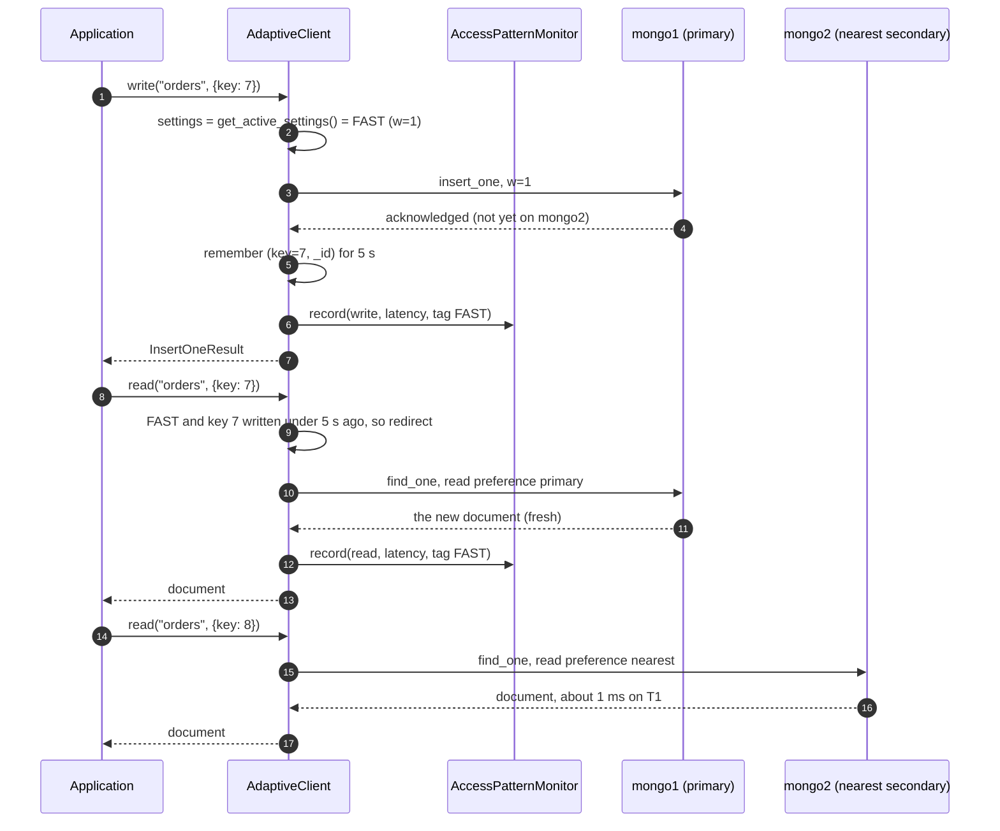

One feedback-loop tick:

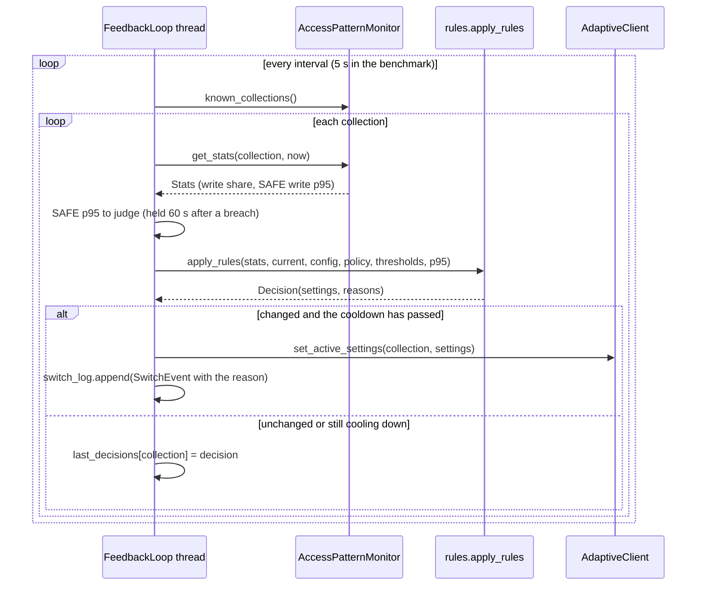

### 3.7 Concurrency

| Part | Runs on | Shared state | Protection |
|---|---|---|---|
| request callers (Locust users) | gevent greenlets in one OS thread (Locust monkey-patches `threading`) | the monitor's window, the client's recent-writes memory | `native_lock()`: a plain OS lock (Section 5.2) |
| `FeedbackLoop` | a `threading.Thread` (a greenlet under Locust) | reads the monitor, sets the client's active settings | same lock for the monitor; settings swap is a single dict assignment |
| each benchmark run | its own `locust` subprocess | nothing: one collection per run, dropped at start | process isolation; watchdog kills the process tree if it overruns |

The locked sections only touch dicts and deques and never wait on I/O, so under gevent's
cooperative scheduling they cannot be interrupted, and with real threads they are ordinary locks.

### 3.8 How the files interact

Everything below was read from the code on this branch: solid arrows are `import` statements
(extracted from every `.py` file with Python's `ast` module); dashed arrows are run-time
interactions (subprocesses, `docker exec`, database calls, files written and read). One graph per
concern, so each stays readable.

#### (a) The middleware: `adaptive_layer/`

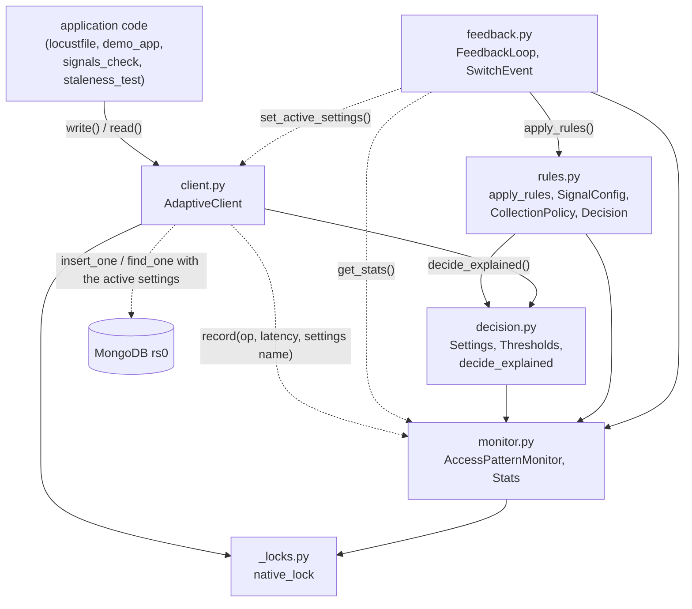

The client never imports the feedback loop; the loop pushes settings into the client through
`set_active_settings()`. `rules.py` and `decision.py` are pure (no I/O), which is why they are the
most heavily unit-tested files.

#### (b) One load-test run, end to end

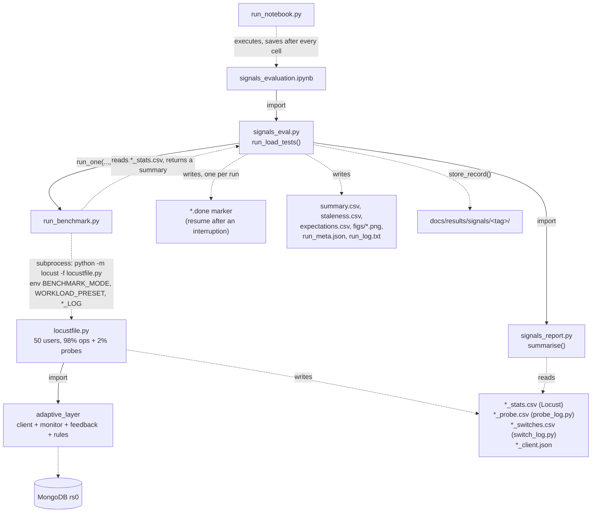

#### (c) The test bed: distances and the pinned primary

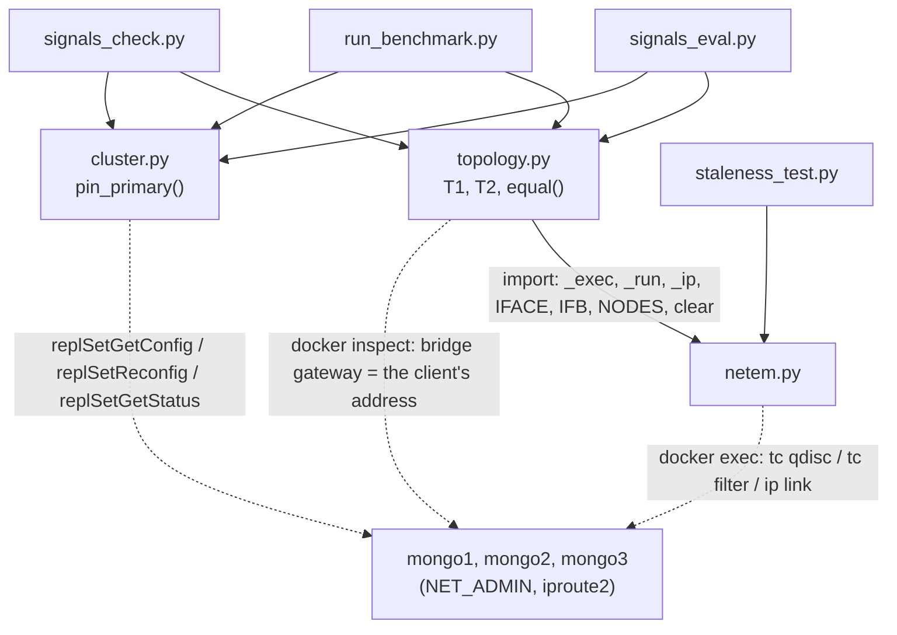

#### (d) The other entry points

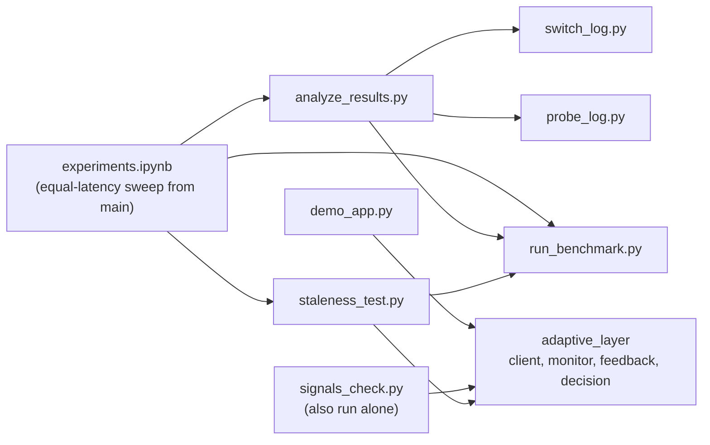

#### (e) Which test covers which file

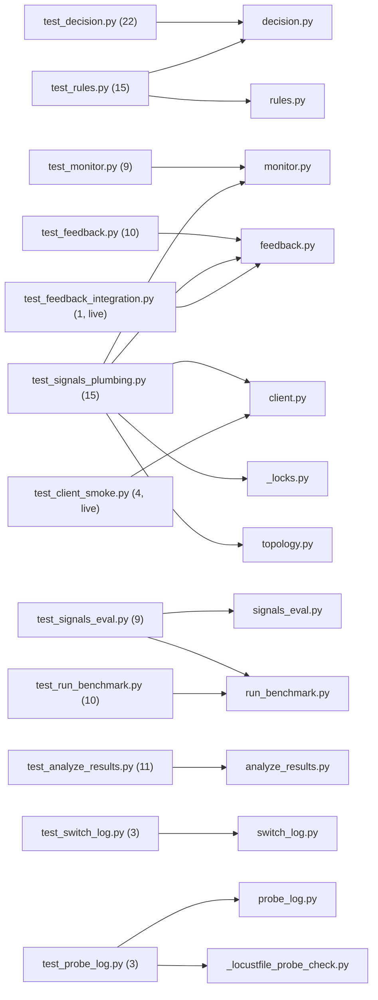

Numbers in brackets are the tests pytest collects from each file (112 in total); "live" files need
the running replica set.

### 3.9 Every file, what it does

Line counts are from the files on this branch. "Reads / writes" lists files, databases and
external commands; in-memory only means the file touches nothing outside the process.

#### Middleware — `adaptive_layer/`

| File | Lines | What it does | Main contents | Reads / writes | Used by |
|---|---|---|---|---|---|
| `__init__.py` | 0 | Marks the package | – | – | – |
| `client.py` | 189 | The only object the application talks to. `write()` / `read()` look up the collection's active settings and apply them (write concern; read concern + read preference). Logs every operation, failed ones too, to the monitor with its latency and settings name. Per-key read-your-own-writes (#6): remembers the `key_field` value and `_id` of each written document for N s, and sends a FAST read that asks for one of them by equality to the primary, counting it in `redirected_reads` | `AdaptiveClient` (`write`, `read`, `set_active_settings`, `get_active_settings`, `_remember`, `_recently_written`, `_log_op`, `mongo_client`); `_resolve_read_preference()` | MongoDB collections (pymongo); nothing on disk | locustfile, signals_check, staleness_test, demo_app, tests |
| `monitor.py` | 153 | Sliding-window statistics per collection: read/write counts, write share, write rate, seconds since last write, and the p95 write latency per settings name (for the budget, #9). Thread-safe with `native_lock` | `Stats` (`write_share`, `write_p95`), `NEUTRAL_STATS`, `AccessPatternMonitor` (`record`, `get_stats`, `known_collections`, `_prune`), `_p95()` | in-memory only | client, feedback, rules, decision |
| `decision.py` | 130 | The traffic rule and the vocabulary of settings. Write share > 0.40 → SAFE, < 0.15 → FAST, else MODERATE; hysteresis (#8) keeps SAFE above 0.35 and FAST below 0.20 when the margin is set; every result comes with its reason (#10) | `Settings`, `SAFE_SETTINGS`, `FAST_SETTINGS`, `MODERATE_SETTINGS`, `LEVELS`, `BY_NAME`, `Thresholds` (with `hysteresis`), `decide_explained()`, `decide()`, `settings_name()` | pure (no I/O) | rules, feedback, client, switch_log, locustfile, tests |
| `rules.py` | 109 | The full decision for one collection: traffic rule → SAFE latency budget (#9: SAFE → MODERATE when SAFE writes' p95 > 100 ms with ≥ 20 samples) → policy clamp (#5: floor / ceiling), collecting a reason at each step | `SIGNALS_THRESHOLDS` (hysteresis 0.05), `SignalConfig` (budget 100 ms, 20 samples, 60 s back-off), `CollectionPolicy` (`clamp`), `NO_POLICY`, `Decision` (`reason`), `apply_rules()` | pure (no I/O) | feedback, locustfile, signals_check, tests |
| `feedback.py` | 157 | The control loop. A background thread that, every interval, decides each known collection, applies a change only when it differs and the cooldown has passed, remembers a budget breach for 60 s so it does not bounce straight back into SAFE, applies policies at start-up, and logs every switch with its reason | `SwitchEvent` (with `reason`), `FeedbackLoop` (`decide`, `tick`, `run`, `start`, `stop`, `_safe_write_p95`, `switch_log`, `last_decisions`) | in-memory only (reads the monitor, writes the client's active settings) | locustfile, signals_check, staleness_test, demo_app, tests |
| `_locks.py` | 26 | Returns a plain OS lock even when gevent has monkey-patched `threading` (as Locust does). Fix for the overnight hang (§5.2) | `native_lock()` | – | client, monitor |

#### Evaluation pipeline — `benchmark/`

| File | Lines | What it does | Main contents | Reads / writes | Used by |
|---|---|---|---|---|---|
| `__init__.py` | 0 | Marks the package | – | – | – |
| `locustfile.py` | 279 | The workload Locust runs. Builds one shared client, monitor and (for adaptive modes) feedback loop per run; mode `static_fast` / `static_moderate` / `static_safe` / `adaptive` / `adaptive_signals`; 10 workload presets (write probability and key choice); 2% of iterations are staleness probes (write, then read back by `_id`) | `current_write_probability()`, `pick_key()`, `on_test_start()`, `on_test_stop()`, `AdaptiveMongoUser` (`read_or_write`, `_probe`, `_report`) | env `BENCHMARK_*`; MongoDB db `benchmark`; writes `*_probe.csv`, `*_switches.csv`, `*_client.json` (Locust itself writes `*_stats.csv`, `*_stats_history.csv`, `*_failures.csv`, `*_exceptions.csv`) | run_benchmark (as a subprocess) |
| `run_benchmark.py` | 323 | Runs one Locust subprocess per (configuration × preset), on an equal latency level or a topology, with the per-preset run lengths; summarises Locust's CSV; the watchdog kills a run that overruns by killing its whole process tree | `CONFIGS`, `ADAPTIVE_CONFIGS`, `PRESETS`, `FULL_DEFAULT`, `FULL_OVERRIDES`, `params_for()`, `run_one()`, `_run_with_watchdog()`, `_kill_tree()`, `run_suite()`, `results_dir_for()`, `topology_dir_for()`, `main()` | starts `locust`; reads `*_stats.csv`; result folders `results/write_share_eval/latency_<N>ms/rep<k>/` or `results/signals_eval/topology_<name>/rep<k>/` | signals_eval, staleness_test, analyze_results, signals_report, experiments.ipynb, tests |
| `staleness_test.py` | 250 | The isolated staleness experiment: for each scenario, write a unique marker and immediately read it back, 200 trials (adaptive_cold 60, spaced 2 s apart). Scenarios: static_fast, static_moderate, static_safe, adaptive_hot (warmed into SAFE), adaptive_cold (warmed into FAST) | `measure_static()`, `measure_adaptive_hot()`, `measure_adaptive_cold()`, `_one_trial()`, `run_all()`, `run_suite()`, `main()` | MongoDB db `staleness_test`; `run_suite()` writes `staleness.csv` (signals_eval writes `staleness_<setup>.csv` itself) | signals_eval, experiments.ipynb |
| `analyze_results.py` | 565 | Analysis for the equal-latency sweep notebook: loads every run folder, aggregates over repeats (mean and std), pools staleness and probes, builds the time-in-settings tables and all charts | `run_analysis()`, `load_all()`, `aggregate_benchmark()`, `pool_staleness()`, `load_switch_timelines()`, `load_probes()`, `split_config()`, the `make_*_chart()` functions | reads `results/write_share_eval/…`; writes summary CSVs and `fig_*.png` there | experiments.ipynb, tests |
| `signals_eval.py` | 605 | Everything the evaluation notebook runs: the `Plan` and its time estimate, preflight checks, live checks, load tests with `.done` resume markers and one retry after a watchdog kill, the staleness experiment, analysis (integrity checks and the expectations stated before the run), five figures, and the committable record | `Plan`, `CORE_PRESETS`, `estimate()`, `preflight()`, `run_live_checks()`, `run_load_tests()`, `run_staleness()`, `analyse()`, `integrity()`, `expectations()`, `figure_metric()`, `figure_settings()`, `figure_staleness()`, `store_record()`, `write_meta()`, `Log` | `results/signals_eval/<tag>/`: `run_meta.json`, `run_log.txt`, `preflight.json`, `checks.json`, `*.done`, `staleness_<setup>.csv`, `summary.csv`, `staleness.csv`, `expectations.csv`, `figs/*.png`; copies the record to `docs/results/signals/<tag>/` | signals_evaluation.ipynb, tests |
| `signals_check.py` | 251 | Five live scenarios, PASS/FAIL each: C1 distances, C2 own writes (#6), C3 policy (#5), C4 budget (#9), C5 hysteresis (#8); each also checks every switch has a reason (#10) | `Traffic`, `make()`, `session()`, `c1_distances()` … `c5_hysteresis()`, `SCENARIOS`, `main()` | MongoDB db `signals_check`; applies topologies; writes `results/signals_eval/checks.json` when run alone | signals_eval, command line |
| `signals_report.py` | 114 | Turns topology run folders into one table: read/write p50 and p95, failures, stale probes overall and per setting, time in each setting, switch count and most common reasons, redirected reads | `summarise()`, `to_markdown()`, `_kind()`, `main()` | reads `topology_*/rep*/` CSVs and JSON; writes `summary.csv` when run alone | signals_eval |
| `run_notebook.py` | 44 | Runs a notebook headlessly with its own kernel, saving after every cell | `main()` | reads and rewrites the `.ipynb` | command line |
| `probe_log.py` | 41 | The staleness-probe tally per settings name | `ProbeTally` (`record`, `totals`, `write`), `read_probe_csv()` | writes / reads `*_probe.csv` (`settings, probes, stale`) | locustfile, analyze_results, signals_report, tests |
| `switch_log.py` | 44 | The switch log of an adaptive run and the time spent in each setting | `write_switch_log()`, `time_in_settings()` | writes / reads `*_switches.csv` (`event, seconds, settings, write_share, reads, writes, reason`) | locustfile, analyze_results, signals_report, tests |

#### Test bed — `benchmark/` and Docker

| File | Lines | What it does | Main contents | Reads / writes | Used by |
|---|---|---|---|---|---|
| `netem.py` | 88 | Equal one-way delay between the nodes with `tc netem`; `clear()` removes every delay including the topology's ingress shaping | `NODES`, `IFACE`, `IFB`, `LATENCY_LEVELS_MS`, `LATENCY_LABELS`, `apply_latency()`, `clear()`, `measure_rtt_ms()`, `_exec()`, `_ip()` | `docker exec` / `docker inspect` on mongo1–3 | topology, run_benchmark, staleness_test, signals_check, tests |
| `topology.py` | 201 | Unequal distances (#1): per-destination delays between nodes, and both directions of each node's link to the client (replies on egress, requests through an `ifb` device) | `Topology`, `T1`, `T2`, `equal()`, `by_name()`, `plan_commands()` (pure), `apply()`, `clear()`, `applied()`, `host_ip()`, `measure_client_rtts()`, `main()` | `docker exec` (tc, ip link) and `docker inspect`; direct pymongo pings to each node | run_benchmark, signals_eval, signals_check, tests |
| `cluster.py` | 95 | Pins the primary (#12): mongo1 gets election priority 10, chained replication is turned off, then it waits until mongo1 is primary and both secondaries copy straight from it | `pin_primary()`, `node_states()`, `sync_sources()`, `wait_until()` | `replSetGetStatus`, `replSetGetConfig`, `replSetReconfig` | run_benchmark, signals_eval, signals_check |
| `docker-compose.yml` | – | Three services `mongo1:27017`, `mongo2:27018`, `mongo3:27019` in replica set `rs0`, with named volumes, one bridge network and `NET_ADMIN` | – | – | the whole test bed |
| `docker/mongo/Dockerfile` | – | `mongo:7.0` plus `iproute2` (`tc`, `ifb`) and `iputils-ping` | – | – | docker-compose |

#### Entry points

| File | What it does | Reads / writes |
|---|---|---|
| `signals_evaluation.ipynb` | The full evaluation in one notebook: settings (profiles `FULL`, `FULL_ALL`, `SMOKE`, `CUSTOM`; `RUN_TAG` to resume), plan and estimate, preflight, live checks, load tests, staleness, results tables and figures, stored record. The committed copy contains the outputs of run `FULL_2026-10-19_1452` | everything `signals_eval.py` writes |
| `experiments.ipynb` | The equal-latency sweep notebook from `main` (traffic rule; static fast / moderate / safe and adaptive) | `results/write_share_eval/` |
| `demo_app.py` (150 lines) | Scripted console demo: read-heavy phase → FAST, write burst → SAFE, mixed → MODERATE, printing stats and settings after each phase | MongoDB db `demo`, collection `live_demo` |

#### Tests — `tests/` (112 tests)

| File | Tests | What it checks |
|---|---|---|
| `test_decision.py` | 22 | Every branch of the traffic rule, exact-threshold boundaries, independence from the absolute write rate, threshold validation |
| `test_rules.py` | 15 | Reasons, hysteresis in both directions, non-overlapping bands, the latency budget (over, within, unmeasured, never touching FAST/MODERATE), policy floor/ceiling and its precedence over the budget |
| `test_monitor.py` | 9 | Window counts, infinite read/write ratio, pruning, validation |
| `test_feedback.py` | 10 | Tick orchestration with a fake clock, client and monitor: first switch, cooldown, unchanged decisions, several collections, switch log. Its fakes are reused by other tests |
| `test_signals_plumbing.py` | 15 | p95 per settings name and ageing out; budget back-off, minimum samples and cooldown; policy at start-up; reasons in a traffic-only loop; the client's key memory, redirect counting and failed-write logging; `native_lock`; topology command plans (T1, equal, names) |
| `test_signals_eval.py` | 9 | The default plan and its time estimate, all 10 presets still available, resume markers, expectations on matching and contradicting results, integrity checks, the watchdog killing a hung parent + child process, one retry then a recorded failure |
| `test_run_benchmark.py` | 10 | Run lengths and scaling, result folder layout, configurations and presets, every combination run and delays always cleared, switch-log paths only for adaptive modes |
| `test_analyze_results.py` | 11 | Analysis on synthetic result trees: repeats, mean and std, staleness pooling, switch timelines, figures written, filters, missing rows, probe pooling |
| `test_switch_log.py` | 3 | Settings names, time in settings adds up to the run length, a run with no switches |
| `test_probe_log.py` | 3 | Probe tally per setting, an empty file, the Locust probe path end to end with a fake client |
| `test_client_smoke.py` | 4 (live) | Against the real replica set: SAFE write then read, monitor wiring, two collections with different settings, the MODERATE default |
| `test_feedback_integration.py` | 1 (live) | The real loop on the real replica set escalates to SAFE on a write burst and relaxes to FAST on reads |
| `_locustfile_probe_check.py` | helper | Fake client used by `test_probe_log.py` to drive the Locust probe code without a database |
| `__init__.py` | – | Marks the package |

#### Documentation, results and project files

| File | What it is |
|---|---|
| `README.md` | Pitch, quickstart, links to the docs |
| `docs/FINAL_REPORT.md` | This report |
| `docs/SIGNAL_RULES.md` | The eight additions in detail, with parameters and live results |
| `docs/PROJECT_DOCUMENTATION.md` | Architecture, data flow and file reference |
| `docs/SHOWCASE.md` | Runbook for a live demo |
| `docs/replica_set_setup.md` | One-time replica-set setup (hosts file, `rs.initiate`) |
| `docs/demo_runs/demo_run_2026-09-10.log` | Saved transcript of a `demo_app.py` run |
| `docs/results/signals/FULL_2026-10-19_1452/data/` | The run's tables: `summary.csv`, `staleness*.csv`, `expectations.csv`, `checks.json`, `preflight.json`, `run_meta.json`, `run_log.txt`, and for each of `topology_EQUAL-0ms`, `topology_T1`, `topology_T2` the per-run Locust stats, probe, switch and client files (78 files each) |
| `docs/results/signals/FULL_2026-10-19_1452/figs/` | The five charts used in Section 7 |
| `plan/exec_plan.md` | The original phase-by-phase build plan |
| `requirements.txt` | `pymongo`, `pytest`, `pandas`, `matplotlib`, `locust`, `ipykernel`, `nbclient` |
| `.gitignore` | Caches, the virtual environment, raw `results/` output |
| `results/.gitkeep` | Keeps the otherwise ignored `results/` folder in git |

---

## 4. The additions: why, how, and justification

Every addition is **opt-in**. `FeedbackLoop(client, monitor)` with no extra arguments behaves exactly
like `main`. That is why the benchmark can run `adaptive` (traffic rule only) and `adaptive_signals`
(with the additions) side by side. The middleware changes total about 390 lines
(`client.py` +100, `decision.py` +44, `feedback.py` +61, `monitor.py` +49, `rules.py` 109 new,
`_locks.py` 26 new). The new decision pipeline:

```
 Stats ─► traffic rule + hysteresis (#8) ─► latency budget (#9) ─► policy floor/ceiling (#5) ─► Decision(settings, reasons #10)
 and, per read, inside the client:  FAST read of a key written < 5 s ago by this client ─► primary (#6)
```

`apply_rules()` (`adaptive_layer/rules.py`) is a **pure function** of plain values, so each step is
unit-tested with hand-built inputs:

```python
def apply_rules(stats, current=None, config=None, policy=NO_POLICY,
                thresholds=DEFAULT_THRESHOLDS, safe_write_p95_ms=None) -> Decision:
    settings, why = decide_explained(stats, thresholds, current)
    reasons = [why]

    if (config is not None and settings == SAFE_SETTINGS and config.write_p95_budget_ms is not None
            and safe_write_p95_ms is not None and safe_write_p95_ms > config.write_p95_budget_ms):
        settings = MODERATE_SETTINGS
        reasons.append(f"SAFE write p95 {safe_write_p95_ms:.0f} ms > budget "
                       f"{config.write_p95_budget_ms:g} ms -> MODERATE")

    settings, clamp_reason = policy.clamp(settings)          # the application has the last word
    if clamp_reason:
        reasons.append(f"{clamp_reason} -> {settings_name(settings)}")
    return Decision(settings, tuple(reasons))
```

---

### #1 Nodes at different distances — `benchmark/topology.py` (complexity 6)

**Why.** FAST exists to read from a *nearby* replica. With every node equally far (Section 2, step 3),
no experiment could show a benefit, only FAST's staleness. A fair evaluation needs a client that
is near one replica and far from the primary, as happens when an app server sits in a different
region from the primary.

**How.** Each node delays its own outgoing traffic with Linux `tc netem`, one `prio` band per
destination. The client runs on the Windows host, which cannot get `tc` rules under Docker Desktop.
So each node also delays **both directions** of its link to the host: replies on egress, requests
on ingress through an `ifb` device.

```python
for i, (ip, delay) in enumerate(dests):          # peers, and the host (the client) for replies
    band = i + 2
    cmds.append(f"tc qdisc add dev eth0 parent 1:{band} handle {band * 10}: netem delay {delay:g}ms limit 100000")
    cmds.append(f"tc filter add dev eth0 protocol ip parent 1: prio {band} u32 match ip dst {ip}/32 flowid 1:{band}")
if extra > 0:                                    # requests from the client: the other half, on ingress
    cmds += ["ip link add ifb0 type ifb", "ip link set ifb0 up",
             "tc qdisc add dev eth0 handle ffff: ingress",
             f"tc filter add dev eth0 parent ffff: protocol ip u32 match ip src {host_ip}/32 "
             "action mirred egress redirect dev ifb0",
             f"tc qdisc add dev ifb0 root netem delay {extra / 2.0:g}ms limit 100000"]
```

**Justification.** Delaying only replies was tried first (on `feature/next-level`). It made
read-after-write look far fresher than reality, about 5% stale in T1 instead of about 38%, because
a write reached the primary instantly. Delaying both directions fixes that.
The distances follow the cloud figures already cited in `netem.py`: 86 ms ≈ a transatlantic round
trip, 10 ms ≈ neighbouring regions.

| Setup | Node round trips | Client round trips (measured in this run's preflight) | What it represents |
|---|---|---|---|
| **EQUAL-0** | 0 ms | ~1 ms to all | the original test bed |
| **T1** "far primary" | 86 ms between all nodes | mongo2 **1.9 ms**, mongo1 (primary) **87.5 ms**, mongo3 87.0 ms | app server next to a secondary, primary across an ocean |
| **T2** "regional pair" | mongo1–mongo2 10 ms, mongo3 86 ms | mongo2 ~1 ms, mongo1 ~11 ms, mongo3 ~87 ms | primary in the neighbouring region; a majority needs only the near pair |

### #12 Pinned primary, no chained replication — `benchmark/cluster.py` (complexity 2)

**Why.** "Far from the primary" only means something if the primary is always the same node, and
MongoDB re-elects after any restart. Separately, with *chained replication* a secondary may copy
from the other secondary instead of the primary. The extra hop added a whole inter-node delay: in
one earlier T1 run (mongo2 syncing from mongo3) FAST read **100%** stale instead of **27%**
(recorded in `plan/next_level_plan.md`, N0.3).

**How.** Give mongo1 priority 10, turn chaining off, and wait until the set is healthy and both
secondaries copy directly from mongo1:

```python
for member in cfg["members"]:
    member["priority"] = priority if member["host"].split(":")[0] == node else 1
cfg.setdefault("settings", {})["chainingAllowed"] = False
cfg["version"] += 1
c.admin.command("replSetReconfig", cfg)
# then wait: mongo1 PRIMARY, two SECONDARY, sync source of both == mongo1
```

Every run's preflight confirmed this state: *"mongo1 PRIMARY, sync sources {mongo2: mongo1, mongo3: mongo1}"*.

### #11 Static MODERATE baseline (complexity 2)

**Why.** Adaptive was compared only with the two extremes. MODERATE (`w=1`, primary reads) is the
honest baseline: whenever FAST has no distance advantage, MODERATE is as fast as FAST and never
stale. **How.** A fifth configuration, `static_moderate`, in the Locust file, the runner, the
staleness experiment and the analysis.

### #6 Read-your-own-writes per key — `adaptive_layer/client.py` (complexity 4)

**Why.** Under FAST, a user who saves something and immediately reloads it may not see it: the read
goes to a secondary that has not received the write yet. In this run's live check C2 on T1 this
happened in **40 of 100** attempts. Switching the whole collection to primary reads (MODERATE) fixes it, but
makes *every* read pay the 87 ms trip to the primary.

**How.** The client remembers, for 5 s, the key and `_id` of every document it wrote. A FAST read
that asks for one of them **by equality** goes to the primary; all other reads stay `nearest`:

```python
def read(self, collection, query):
    settings = self.get_active_settings(collection)
    read_preference = settings.read_preference
    # primaryPreferred already reads from the primary: nothing to redirect
    if (read_preference not in ("primary", "primaryPreferred") and self.read_own_writes_seconds
            and self._recently_written(collection, query)):
        read_preference = "primary"
        self.redirected_reads += 1
    ...

def _remember(self, collection, doc):            # called after every successful write
    now = time.monotonic()
    with self._recent_lock:
        recent = self._recent[collection]          # OrderedDict, oldest first
        for field in {self.key_field, "_id"}:
            if field in doc:
                recent.pop((field, doc[field]), None)
                recent[(field, doc[field])] = now
        cutoff = now - self.read_own_writes_seconds
        while recent and next(iter(recent.values())) < cutoff:
            recent.popitem(last=False)             # bounded memory
```

**Justification.** Only the reads that need the guarantee pay for it. 5 s comfortably outlasts the
replication delay of this test bed (well under a second even at 86 ms between nodes). Memory is
bounded by the writes of the last 5 s.

### #8 Hysteresis — `adaptive_layer/decision.py` (complexity 1)

**Why.** A share hovering at a threshold (e.g. 0.39 ↔ 0.41) flips the setting after every
cooldown. Each flip changes durability and latency for all callers.

**How.** Enter at the old thresholds, leave only past a margin of 0.05: SAFE is left below 0.35,
FAST above 0.20.

```python
h = thresholds.hysteresis
if h and current == SAFE_SETTINGS and share > high - h:
    return SAFE_SETTINGS, f"write share {share:.2f} > {high - h:.2f} (hysteresis: staying SAFE)"
if h and current == FAST_SETTINGS and share < low + h:
    return FAST_SETTINGS, f"write share {share:.2f} < {low + h:.2f} (hysteresis: staying FAST)"
```

**Justification.** 0.05 is a third of the 15-point FAST zone. The two "stay" bands are validated
never to overlap (`hysteresis < (high − low) / 2`). The default is 0, which is exactly the old rule.

### #9 Latency budget for SAFE — `monitor.py`, `rules.py`, `feedback.py` (complexity 4)

**Why.** SAFE assumes a majority write is affordable. On T1 it costs ~250 ms per write, and SAFE
also reduced throughput (226 req/s instead of the offered ~250 on the balanced workload). For an
interactive application that can be the wrong trade.

**How.** The client tells the monitor each write's latency and the settings it ran under. When the
p95 of SAFE writes in the window (at least 20 samples) exceeds **100 ms**, the decision steps down
to MODERATE. Once out of SAFE there are no new SAFE samples, so the loop **remembers the breach for
60 s**; without that memory it would bounce straight back:

```python
measured = stats.write_p95("SAFE")                      # (p95 ms, sample count) or None
if measured is not None and measured[1] >= cfg.budget_min_samples:
    if measured[0] > cfg.write_p95_budget_ms:
        self._budget_breach[collection] = (now, measured[0])
        return measured[0]
breach = self._budget_breach.get(collection)
if breach is not None and now - breach[0] < cfg.budget_backoff_seconds:
    return breach[1]                                    # still "over budget" for 60 s
```

**Justification.** 100 ms is the commonly cited response-time limit for an action to feel
instant (general usability guidance, not something we measured). This is a deliberate
*performance policy*: it trades majority durability for latency. A collection that must stay durable
whatever the cost sets `floor="SAFE"` (#5), which overrides it.

### #5 Per-collection floor and ceiling — `rules.py` (complexity 2)

**Why.** Collections differ: orders must never be written with `w=1`, while logs never need SAFE.
One rule for every collection ignores that.

**How.** A `CollectionPolicy` applied **last**, after every other rule, and also at start-up, so a
collection never runs its first operations on the MODERATE default:

```python
def clamp(self, settings):
    level = LEVELS.index(settings_name(settings))          # FAST < MODERATE < SAFE
    if self.floor and level < LEVELS.index(self.floor):
        return BY_NAME[self.floor], f"policy floor {self.floor}"
    if self.ceiling and level > LEVELS.index(self.ceiling):
        return BY_NAME[self.ceiling], f"policy ceiling {self.ceiling}"
    return settings, None

FeedbackLoop(client, monitor, policies={"orders": CollectionPolicy(floor="SAFE"),
                                        "logs":   CollectionPolicy(ceiling="FAST")})
```

**Justification.** The application knows what the traffic cannot show. Putting the policy last
means no automatic rule can weaken an explicit requirement.

### #10 Say why it switched (complexity 2)

**Why.** "It switched to MODERATE" is not explainable; "SAFE write p95 264 ms > budget 100 ms" is.
**How.** Every step appends a reason. `SwitchEvent.reason` stores the joined string, the switch-log
CSV has a `reason` column, and `FeedbackLoop.last_decisions` holds the latest decision for every
collection. A real switch from the run:

```
write share 0.49 > 0.35 (hysteresis: staying SAFE); SAFE write p95 264 ms > budget 100 ms -> MODERATE
```

### Complexity summary

| # | Addition | Complexity | Where |
|---|---|---|---|
| 1 | unequal distances | 6 | test bed |
| 5 | per-collection policy | 2 | middleware |
| 6 | read-your-own-writes per key | 4 | middleware |
| 8 | hysteresis | 1 | middleware |
| 9 | SAFE latency budget | 4 | middleware |
| 10 | switch reasons | 2 | middleware |
| 11 | MODERATE baseline | 2 | evaluation |
| 12 | pinned primary, no chaining | 2 | test bed |

---

## 5. Engineering problems found and fixed on the way

### 5.1 Failed operations disappeared from the monitor

During live testing of the (later dropped) node-failure scenario, majority writes timed out. The
monitor only recorded *successful* operations, so the timed-out writes vanished from the window.
The write share looked like 0%, and the traffic-only layer jumped to FAST, reading from a frozen
secondary. **Fix (kept):** the client logs every *attempted* operation in a `finally` block; the
window describes what the application asks for, not what succeeded.

### 5.2 The overnight run hung for 6 hours

The first 10-hour run stopped making progress after 97 of 200 runs (all with 0 failures). One
Locust run never exited. Its stats showed 199 of 200 simulated users stopped at the 180 s mark,
one user still sending ~5 requests/s for six hours, and a single error:
`RuntimeError('Semaphore released too many times')`.

**Cause.** Locust runs on gevent, which monkey-patches `threading`. The locks added to the monitor
and client therefore became gevent semaphores. One broke while Locust killed the users, and the
user's request code (which catches all errors to report them) swallowed the error and kept going.

**Fix 1: plain OS locks** (`adaptive_layer/_locks.py`). This is safe because the locked sections
only touch dicts and deques and never wait on anything, so under gevent's cooperative switching
they are never interrupted:

```python
def native_lock():
    if "gevent.monkey" in sys.modules:
        from gevent import monkey
        if monkey.is_module_patched("threading"):
            return monkey.get_original("threading", "Lock")()
    return threading.Lock()
```

**Fix 2: a watchdog.** Each run is killed 120 s past its planned length, together with its child
processes (on Windows the venv's `python.exe` is a launcher with a child). It is retried once, then
recorded as failed, so one stuck run cannot block an evaluation:

```python
proc = subprocess.Popen(cmd, cwd=REPO_ROOT, env=env, stdout=subprocess.PIPE, stderr=subprocess.PIPE, text=True)
try:
    out, err = proc.communicate(timeout=timeout_s)
except subprocess.TimeoutExpired:
    subprocess.run(["taskkill", "/T", "/F", "/PID", str(proc.pid)], capture_output=True)  # the whole tree
    proc.communicate()
    return None
```

The exact run that hung was repeated 4 times with the fix and no watchdog: all exited normally.
In the final run, no run needed the watchdog or a retry.

---

## 6. Evaluation method

### 6.1 Test bed

Three MongoDB 7.0 containers (Docker Desktop, Windows 11) in replica set `rs0`, with mongo1 pinned
as primary (#12). The load generator is Locust on the host, 50 simulated users at 5 operations/s
each (~250 ops/s), documents with a 2 KB payload over 1,000 keys, and an index on `key`.

#### The three network setups

Round trips as configured in `benchmark/topology.py`, with the client round trips measured in this
run's preflight (T1) and the next-level validation (T2: 12.5 / 0.9 / 87 ms).

**EQUAL-0** — no delays: every node equally close.

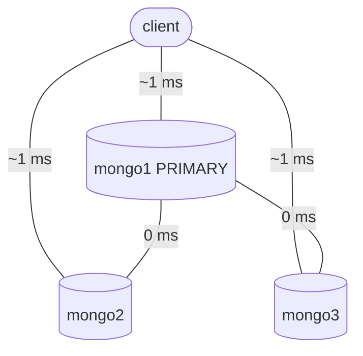

**T1** — far primary: the client sits next to mongo2, an ocean away from the primary.

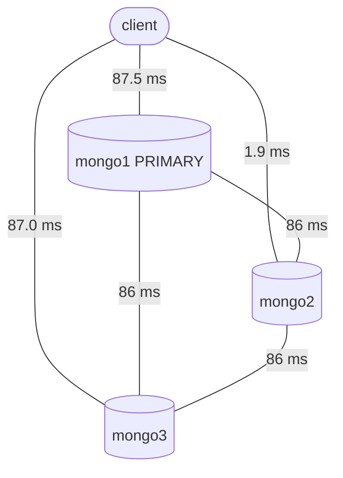

**T2** — regional pair: the primary is in the neighbouring region; a majority needs only mongo1 + mongo2.

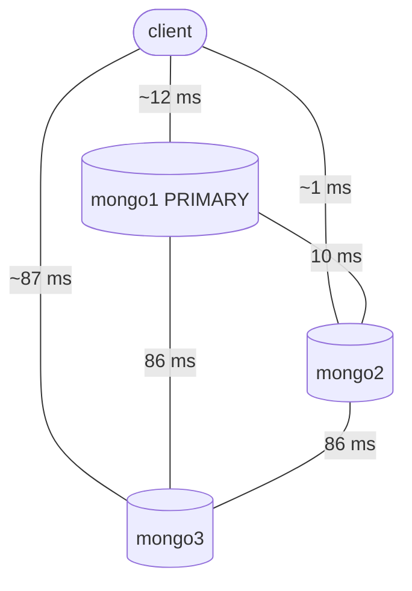

How one node's links are shaped (T1, mongo1):

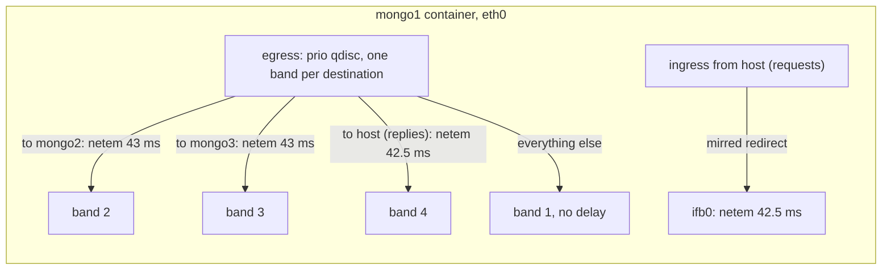

Every node does the same with its own values, so a node pair's round trip is the stated value and
the client's round trip to a node is its extra delay plus the ~1 ms base link.

#### One load-test run

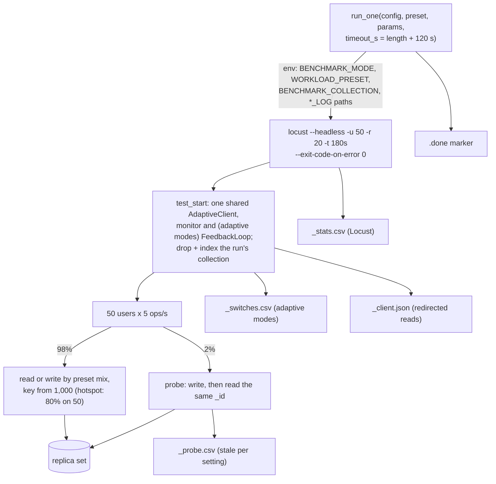

### 6.2 Configurations

| Configuration | What it is |
|---|---|
| `static_fast` | FAST fixed |
| `static_moderate` | MODERATE fixed (#11) |
| `static_safe` | SAFE fixed |
| `adaptive` | the traffic rule of `main` (15 s window, 5 s tick, 10 s cooldown) |
| **`adaptive_signals`** | the same plus hysteresis (#8), the latency budget (#9), read-your-own-writes for 5 s (#6), and switch reasons (#10) |

### 6.3 Workloads (6 of the 10 presets)

| Workload | Writes | Why it is included |
|---|---|---|
| READ_HEAVY | 5% | FAST + read-your-own-writes (#6) |
| READ_HEAVY_HOTSPOT | 5%, 80% of operations on 5% of the keys | the cost of routing hot keys to the primary (#6) |
| MODEST_WRITES | 25% | the MODERATE zone |
| BALANCED | 50% | SAFE and the latency budget (#9) |
| MIXED_BURSTY | 95% ↔ 5% every 15 s | switching, hysteresis (#8), reasons (#10) |
| SPIKE | 5% with a 3 s burst of 90% every 20 s | short bursts |

The four left out add nothing for these additions. WRITE_HEAVY and HOTSPOT behave like BALANCED
(all SAFE). RAMP only tests a slow ramp-up. HIGH_CONCURRENCY is a load test of the layer itself.
They remain available (`FULL_ALL` profile).

Runs last 180 s (SPIKE 108 s): 0.6 × the original 300 s. That leaves 12 window lengths per run
and room for several budget back-off cycles.

### 6.4 What is measured

- **Latency** per operation type (Locust's p50 / p95) and throughput.
- **In-load staleness probes**: 2% of iterations write a document and immediately read it back by
  `_id`. A miss counts as stale, tallied under the settings in force. *These are own-write reads by
  construction* (see Section 9).
- **Time in each setting and every switch with its reason**, from the switch log.
- **Staleness experiment** (`benchmark/staleness_test.py`): 200 isolated write-then-read trials per
  fixed configuration, plus the traffic-only layer warmed into SAFE (`adaptive_hot`) and into FAST
  (`adaptive_cold`, 60 trials).
- **Live checks** (`benchmark/signals_check.py`): one targeted scenario per addition, PASS/FAIL.

### 6.5 Pre-stated expectations and integrity checks

Before the run, the notebook (`benchmark/signals_eval.expectations`) wrote down eight predictions
the design makes. Seven integrity checks guard against a broken run: every run finished, no hung or
retried run, no failed request, probes present, all live checks passed, and the staleness
experiment complete. A failed expectation would have been reported as a finding, not tuned away.

### 6.6 How the run went

| Phase | Time |
|---|---|
| Preflight (Docker, no leftover delays, pinned primary, T1 applies and measures, 112 tests, disk) | 26 s |
| Live checks (5) | 1 min 56 s |
| Load tests (90 runs) | 4 h 15 min 32 s |
| Staleness experiment (3 setups) | 10 min 39 s |
| **Total** | **4 h 28 min** (estimate was 4 h 35 min) |

### 6.7 The evaluation pipeline

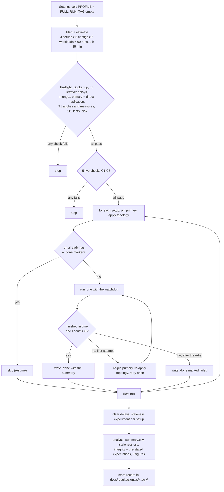

In this run no run hit the watchdog or needed a retry, and nothing needed resuming.

---

## 7. Results

### 7.1 Integrity and expectations: everything held

| Integrity check | Result |
|---|---|
| every planned load-test run finished | ✅ 90/90 |
| no Locust errors or hung runs | ✅ none |
| no run needed a retry | ✅ none |
| no failed requests | ✅ 0 in total (3.78 million requests) |
| every run has staleness probes | ✅ |
| live checks all PASS | ✅ 5/5 |
| staleness experiment done for every setup | ✅ |

| Expectation (stated before the run) | Held? | Detail |
|---|---|---|
| adaptive_signals: no stale probe while in FAST, in any setup (#6) | ✅ | 0 stale of 5,938 probes taken in FAST |
| T1 READ_HEAVY: adaptive_signals uses FAST most of the run | ✅ | FAST 97% of the run |
| T1 READ_HEAVY: adaptive_signals less stale than adaptive and static_fast | ✅ | 0.0% vs 24.6% / 34.5% |
| T1 READ_HEAVY: adaptive_signals reads stay local (median < 20 ms) | ✅ | 3 ms (static_moderate: 88 ms) |
| T1 BALANCED: the latency budget takes adaptive_signals out of SAFE | ✅ | 2 budget switches |
| T2 BALANCED: SAFE within budget, adaptive_signals stays mostly SAFE | ✅ | SAFE 97%, write p95 48 ms |
| EQUAL-0 BALANCED: SAFE within budget, adaptive_signals stays mostly SAFE | ✅ | SAFE 97%, write p95 40 ms |
| static_moderate and static_safe are never stale | ✅ | 0 stale probes |

### 7.2 Live checks

| Check | Result |
|---|---|
| C1 distances (#1, #12) | T1 client: mongo2 0.8 ms, primary mongo1 86.7 ms, mongo3 86.8 ms; nodes 86.3 ms; EQUAL-5 nodes 10.3 ms; primary mongo1 — PASS |
| C2 own writes (#6) | plain FAST 40 / 100 stale → per-key routing **0 / 100** (own-write reads 87.5 ms at the primary), other reads still 2.0 ms — PASS |
| C3 policy (#5) | 5%-write traffic on `floor="SAFE"` → stays SAFE ("policy floor SAFE -> SAFE") — PASS |
| C4 budget (#9) | 60% writes on T1 → MODERATE after 4.2 s: "SAFE write p95 263 ms > budget 100 ms" — PASS |
| C5 hysteresis (#8) | after SAFE, ~38% writes: traffic rule → MODERATE (2 switches); hysteresis → stays SAFE, "write share 0.38 > 0.35 (hysteresis: staying SAFE)" (1 switch) — PASS |

### 7.3 T1 — far primary (the case the additions are for)

| Workload | Configuration | read p50 / p95 ms | write p50 / p95 ms | stale probes | time in FAST / MOD / SAFE % |
|---|---|---|---|---|---|
| READ_HEAVY | static_fast | 8 / 16 | 88 / 91 | **34.5%** | – |
| | static_moderate | 88 / 91 | 88 / 92 | 0% | – |
| | static_safe | 88 / 90 | 230 / 260 | 0% | – |
| | adaptive | 2 / 7 | 88 / 91 | **24.6%** | 97 / 3 / 0 |
| | **adaptive_signals** | **3** / 88 | 88 / 93 | **0%** | 97 / 3 / 0 |
| READ_HEAVY_HOTSPOT | static_fast | 10 / 18 | 88 / 91 | 25.4% | – |
| | adaptive | 2 / 7 | 88 / 93 | 26.5% | 97 / 3 / 0 |
| | **adaptive_signals** | 87 / 91 | 88 / 92 | **0%** | 97 / 3 / 0 |
| BALANCED | static_moderate | 88 / 90 | 88 / 91 | 0% | – |
| | static_safe | 89 / 94 | 240 / 260 | 0% | – |
| | adaptive | 89 / 94 | **240** / 260 | 0.1% | 0 / 3 / 97 |
| | **adaptive_signals** | 88 / 92 | **89** / 260 | 0% | 0 / 87 / 13 |
| MIXED_BURSTY | static_safe | 88 / 92 | 260 / 270 | 0% | – |
| | adaptive | 88 / 91 | 88 / 260 | 0.6% | 0 / 49 / 51 (12 switches) |
| | **adaptive_signals** | 88 / 91 | 88 / 260 | 0.1% | 0 / 87 / 13 (5 switches) |
| SPIKE | static_fast | 2 / 4 | 88 / 120 | 19.2% | – |
| | adaptive | 87 / 90 | 88 / 91 | **10.9%** | 52 / 48 / 0 |
| | **adaptive_signals** | 87 / 90 | 88 / 91 | **0%** | 52 / 48 / 0 |
| MODEST_WRITES | adaptive / adaptive_signals | 88 / 91–92 | 88 / 91–92 | 0% | 0 / 100 / 0 |

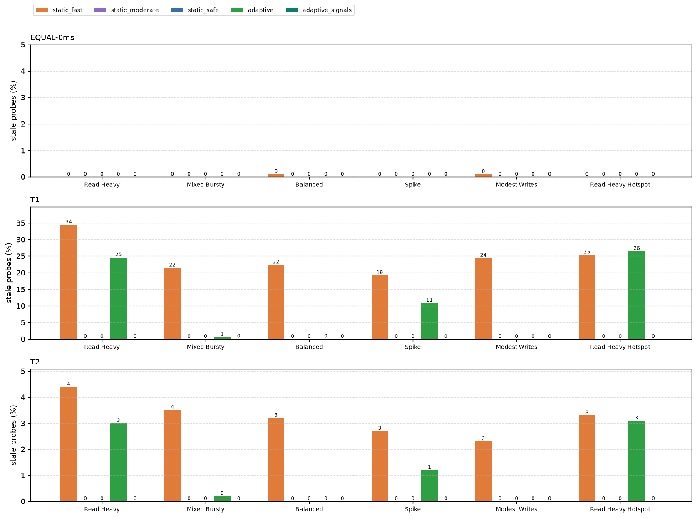

### 7.4 T2 — primary in the neighbouring region

| Workload | Configuration | read p50 / p95 ms | write p50 / p95 ms | stale probes | time in FAST / MOD / SAFE % |
|---|---|---|---|---|---|
| READ_HEAVY | static_fast | 13 / 24 | 17 / 27 | 4.4% | – |
| | static_moderate | 17 / 25 | 18 / 26 | 0% | – |
| | adaptive | 14 / 24 | 18 / 27 | 3.0% | 97 / 3 / 0 |
| | **adaptive_signals** | 17 / 25 | 18 / 27 | **0%** | 97 / 3 / 0 |
| BALANCED | static_safe | 19 / 29 | 36 / 48 | 0% | – |
| | adaptive | 19 / 32 | 35 / 46 | 0% | 0 / 3 / 97 |
| | **adaptive_signals** | 19 / 31 | 35 / 48 | 0% | 0 / 3 / 97 (budget not triggered) |
| SPIKE | adaptive | 15 / 26 | 21 / 33 | 1.2% | 49 / 51 / 0 |
| | **adaptive_signals** | 17 / 24 | 22 / 36 | **0%** | 35 / 56 / 9 |

### 7.5 EQUAL-0 — every node equally close

All five configurations have the same latency: read medians 9–24 ms, write medians 15–24 ms.
These are set by the load generator, not by MongoDB (see Section 9). Fixed FAST was stale in 2 of
5,066 probes. SAFE writes stayed far inside the budget (p95 ≤ 41 ms), so the budget never fired.
`adaptive_signals` made the same choices as `adaptive` everywhere (e.g. BALANCED: SAFE 97% for both).

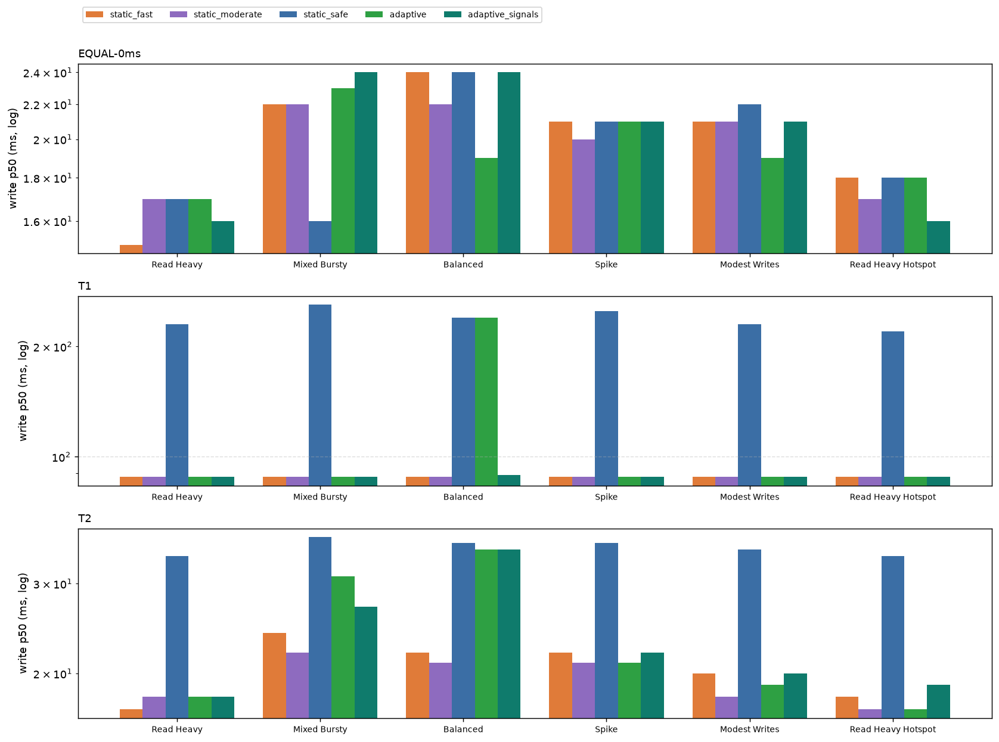

### 7.6 Which setting the layer used

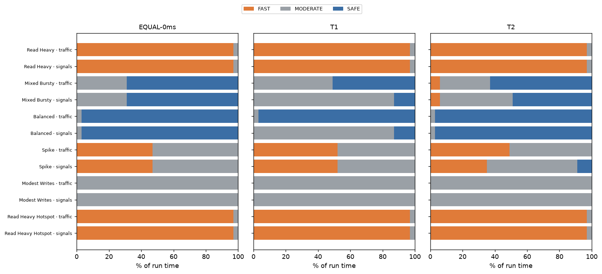

The latency budget's cycle on T1 BALANCED, from the switch log:

| t (s) | to | reason |
|---|---|---|
| 5.0 | SAFE | write share 0.49 > 0.40 |
| 15.0 | MODERATE | write share 0.49 > 0.35 (hysteresis: staying SAFE); SAFE write p95 264 ms > budget 100 ms -> MODERATE |
| 90.1 | SAFE | write share 0.51 > 0.40 (60 s back-off over, SAFE tried again) |
| 100.1 | MODERATE | … SAFE write p95 263 ms > budget 100 ms -> MODERATE |
| 175.1 | SAFE | write share 0.50 > 0.40 |

### 7.7 Staleness experiment (isolated write-then-read, 200 trials)

| Setup | static_fast | static_moderate | static_safe | adaptive_hot (SAFE) | adaptive_cold (FAST) |
|---|---|---|---|---|---|
| EQUAL-0 | 7.5% | 0% | 0% | 0% | 0% (60 trials) |
| T1 | **46.5%** | 0% | 0% | 0% | **33.3%** (60 trials) |
| T2 | 1.5% | 0% | 0% | 0% | 0% (60 trials) |

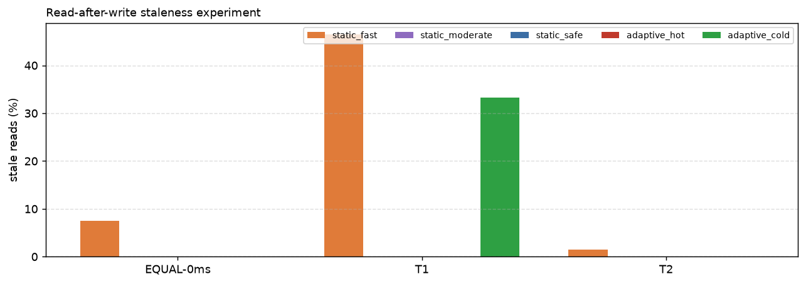

---

## 8. Analysis

### 8.1 Read-heavy with a distant primary: better than every fixed setting

On T1 READ_HEAVY each fixed setting gives up one of the two goals:

- **fixed FAST**: fast reads (8 ms), but 34.5% of own-write reads stale;
- **fixed MODERATE**: never stale, but every read pays the 87 ms trip (88 ms median);
- **traffic-only adaptive**: picks FAST (97% of the time) and inherits its staleness (24.6%).

`adaptive_signals` makes the same FAST choice but sent only **9.4%** of reads to the primary: those
asking for a document this client wrote in the last 5 s. Result: a **3 ms median read and 0 stale
own-write reads**. The cost is visible in the p95 (88 ms): the redirected tenth of reads pays the
primary's distance. **This is the clearest gain of the additions: a combination no fixed setting
offers.** SPIKE shows the same: 0% vs 10.9% stale, at identical latency.

### 8.2 Hot keys: correctness kept, the latency gain is gone

With 80% of traffic on 50 keys, most reads ask for a recently written key, so **60.6%** of reads went
to the primary and the median read rose to 87 ms. That is the same as fixed MODERATE, with
0% vs 26.5% stale. Per-key routing degrades gracefully into "primary reads where needed": correct,
but no faster than MODERATE for this workload. This is expected and is reported as such.

### 8.3 The latency budget: a clear speed-up with an explicit price

On T1 BALANCED, SAFE costs ~240 ms per write and lowers throughput (static_safe 226 req/s,
traffic-only adaptive 228 req/s, against ~250 offered). The budget moved `adaptive_signals` to
MODERATE after measuring 264 ms: **write median 89 ms, 249 req/s**. It tried SAFE again after each
60 s back-off (13% of the run in SAFE, which is why its write p95 is still 260 ms) and left again each time.

The price is **durability**: 87% of writes were acknowledged by the primary alone (`w=1`) instead of
a majority. That is the purpose of a latency budget, and it is why the policy floor (#5) exists.
Where SAFE is cheap (T2 ~35 ms, EQUAL-0 ~24 ms), the budget never fired and SAFE was kept 97% of
the time. The rule is selective, not a blanket weakening.

### 8.4 Hysteresis: works as designed, little room to act in these workloads

The live check C5 shows the mechanism: a 37.5% share after SAFE keeps SAFE instead of flipping.
In the load tests, the presets jump between 5% and 95% writes, far outside the 0.35–0.40 band, so
hysteresis rarely applied. On EQUAL-0 and T2, `adaptive` and `adaptive_signals` made the same
number of switches on MIXED_BURSTY (11 and 12). The drop from 12 to 5 switches on T1 comes mostly
from the budget's back-off, not from hysteresis. Hysteresis is cheap insurance for borderline
workloads; these workloads did not test it hard.

### 8.5 T2 and equal distances: the additions stay out of the way

With the primary close (T2) or everything equal (EQUAL-0), there is little latency to gain or lose.
`adaptive_signals` behaved like `adaptive` (same time-in-setting shares, same SAFE choices) and
removed the remaining own-write staleness: T2 READ_HEAVY 3.0% → 0%, SPIKE 1.2% → 0%.

Two things from these setups are worth stating. FAST still has no real advantage on T2 (read
median 13 ms vs MODERATE's 17 ms) but is 2–4% stale. And on equal distances FAST gains nothing at
all. A layer that knew distances (the dropped #2) would choose MODERATE there. This branch
deliberately does not.

### 8.6 The staleness experiment confirms the scale of the risk

Isolated write-then-read trials (no load-generator delay) show how stale FAST really is when
replication has to cross distance: **46.5%** on T1 and 7.5% even with no injected delay. SAFE and
MODERATE are never stale. The traffic-only layer in FAST (`adaptive_cold`) was 33.3% stale on T1.
That is the exposure that per-key routing removes for a client's own writes.

### 8.7 Overall verdict

| Situation | Best fixed choice | adaptive_signals |
|---|---|---|
| far primary, read-heavy | none is both fast and fresh | **fast and fresh for own writes** (3 ms, 0%) |
| far primary, hot keys | MODERATE | **≈ MODERATE** (87 ms, 0%) |
| far primary, write-heavy | SAFE (durable) or MODERATE (fast) | **MODERATE-like by policy** (89 ms writes); `floor="SAFE"` if durability matters |
| near primary / equal distances | MODERATE or SAFE | **same as the traffic rule**, without own-write staleness |

---

## 9. Limitations and threats to validity

- **The in-load probes measure read-your-own-writes.** A probe writes and then reads *its own*
  document, which is exactly what #6 protects, so `adaptive_signals`' 0% is guaranteed by design for
  this kind of read. Reads of documents written moments ago by *other* clients (other processes)
  are not protected: under FAST they are as stale as for `adaptive` (staleness experiment: 33–46% on T1).
- **No guard against a lagging or failed secondary** (#3/#4 not kept). FAST keeps reading from a
  secondary that falls behind, and SAFE writes wait as long as a majority is unavailable.
- **FAST is still chosen on equal distances** (#2 not kept), where it gains nothing.
- **The budget weakens durability on purpose** (Section 8.3); `floor="SAFE"` is the remedy.
- **One repeat per cell, no error bars.** Single-run stale rates vary: plain FAST was 40–49 / 100 in
  the live checks run on 19 Oct and 28–36 / 100 in earlier runs. Differences of a few percent between runs are noise.
- **Load-generator latency floor.** At equal distances a direct ping to any node takes ~1 ms (C1:
  0.8–1.0 ms), yet every configuration, fixed FAST and fixed SAFE alike, shows 9–24 ms medians in
  the load test. The extra time is therefore spent in the load generator (one Locust process, 50
  users, on Windows), not in MongoDB. Single-digit-ms differences between configurations are not
  effects of the configuration. The differences discussed here (3 vs 88 ms, 89 vs 240 ms, 0 vs 25–35%)
  are an order of magnitude larger.
- **The load generator's slowness also hides some staleness.** Under load, a probe's read happens
  later, giving replication time to catch up. That is why in-load stale rates (e.g. 34.5% on T1) are
  below the isolated experiment's (46.5%).
- **A switch-boundary effect.** One stale probe in SAFE (T1 MIXED_BURSTY): a write made with `w=1`
  just before the switch to SAFE is invisible to a `readConcern: majority` read until a majority has it.
- **Per-process view.** The monitor and the read-your-own-writes memory see only their own process.
- **Uncommitted code.** The run used `d9f7baf` plus the uncommitted branch changes (recorded in
  `run_meta.json` as `d9f7baf+uncommitted`).

---

## 10. Reproducing everything

```bash
docker compose up -d                          # the replica set
python -m pytest -q                           # 112 tests (unit + live-cluster)
python -m benchmark.signals_check             # the 5 live checks (~2 min)
python -m benchmark.topology T1               # apply a topology by hand; `clear` removes it
```

The full evaluation: open `signals_evaluation.ipynb` and Run All (profile `FULL`, ~4 h 35 min), or
headless:

```powershell
.venv\Scripts\python -m benchmark.run_notebook signals_evaluation.ipynb
```

| What | Where |
|---|---|
| this run's tables, figures, switch logs, probe tallies, Locust stats | `docs/results/signals/FULL_2026-10-19_1452/` |
| raw output incl. Locust history and the full log | `results/signals_eval/FULL_2026-10-19_1452/` (not in git) |
| the eight additions in detail | [`SIGNAL_RULES.md`](SIGNAL_RULES.md) |
| every file and test | [`PROJECT_DOCUMENTATION.md`](PROJECT_DOCUMENTATION.md) |
| the four additions not kept | `git stash list` → "adaptive-signals: all 12 changes …" |

---

## 11. Conclusion

The original layer could only ask "how many writes?". The eight additions let it also respect where
the replicas are (#1, #12), what a user just wrote (#6), what SAFE actually costs (#9), what the
application requires (#5), and how steady and explainable its choices are (#8, #10). They also give
it a fair baseline (#11). Each is small (complexity 1–6, ~390 lines of middleware in total),
opt-in, unit-tested, and was checked live.

The evaluation shows the additions where they matter, with a far primary:
- own-write reads stay fresh **without** giving up local reads;
- slow majority writes are avoided when the application allows it.

Where nothing is at stake (near primary, equal distances), the additions behave like the original
layer. The limits are stated plainly: other clients' fresh writes, no failure guards, a durability
trade by policy. The four dropped proposals address exactly those limits and are ready to add back.

---

## Appendix A: every load-test result

Run `FULL_2026-10-19_1452`, 180 s per run (SPIKE 108 s), 50 users × 5 ops/s. Stale probes =
write-then-read of the same document. "Reads sent to primary by #6" = reads redirected by
read-your-own-writes (adaptive_signals only), as a share of all reads.

#### T1

| Workload | Configuration | read p50 / p95 ms | write p50 / p95 ms | req/s | stale probes | FAST / MOD / SAFE % | switches | reads sent to primary by #6 |
|---|---|---|---|---|---|---|---|---|
| READ_HEAVY | static_fast | 8 / 16 | 88 / 91 | 252 | 287/832 (34.5%) | – | – | – |
|  | static_moderate | 88 / 91 | 88 / 92 | 252 | 0/860 (0.0%) | – | – | – |
|  | static_safe | 88 / 90 | 230 / 260 | 247 | 0/878 (0.0%) | – | – | – |
|  | adaptive | 2 / 7 | 88 / 91 | 253 | 230/934 (24.6%) | 97 / 3 / 0 | 1 | – |
|  | **adaptive_signals** | 3 / 88 | 88 / 93 | 252 | 0/824 (0.0%) | 97 / 3 / 0 | 1 | 3947 (9.4%) |
| READ_HEAVY_HOTSPOT | static_fast | 10 / 18 | 88 / 91 | 252 | 219/862 (25.4%) | – | – | – |
|  | static_moderate | 88 / 92 | 88 / 92 | 252 | 0/904 (0.0%) | – | – | – |
|  | static_safe | 88 / 91 | 220 / 260 | 247 | 0/863 (0.0%) | – | – | – |
|  | adaptive | 2 / 7 | 88 / 93 | 252 | 225/848 (26.5%) | 97 / 3 / 0 | 1 | – |
|  | **adaptive_signals** | 87 / 91 | 88 / 92 | 252 | 0/887 (0.0%) | 97 / 3 / 0 | 1 | 25480 (60.6%) |
| MODEST_WRITES | static_fast | 5 / 13 | 88 / 92 | 252 | 207/848 (24.4%) | – | – | – |
|  | static_moderate | 88 / 92 | 88 / 92 | 252 | 0/869 (0.0%) | – | – | – |
|  | static_safe | 88 / 91 | 230 / 260 | 240 | 0/874 (0.0%) | – | – | – |
|  | adaptive | 88 / 91 | 88 / 91 | 252 | 0/857 (0.0%) | 0 / 100 / 0 | 0 | – |
|  | **adaptive_signals** | 88 / 92 | 88 / 92 | 252 | 0/853 (0.0%) | 0 / 100 / 0 | 0 | 0 (0.0%) |
| BALANCED | static_fast | 4 / 11 | 88 / 92 | 253 | 204/910 (22.4%) | – | – | – |
|  | static_moderate | 88 / 90 | 88 / 91 | 252 | 0/857 (0.0%) | – | – | – |
|  | static_safe | 89 / 94 | 240 / 260 | 226 | 0/834 (0.0%) | – | – | – |
|  | adaptive | 89 / 94 | 240 / 260 | 228 | 1/819 (0.1%) | 0 / 3 / 97 | 1 | – |
|  | **adaptive_signals** | 88 / 92 | 89 / 260 | 249 | 0/893 (0.0%) | 0 / 87 / 13 | 5 | 0 (0.0%) |
| MIXED_BURSTY | static_fast | 2 / 6 | 88 / 92 | 252 | 193/899 (21.5%) | – | – | – |
|  | static_moderate | 88 / 91 | 88 / 92 | 252 | 0/838 (0.0%) | – | – | – |
|  | static_safe | 88 / 92 | 260 / 270 | 224 | 0/765 (0.0%) | – | – | – |
|  | adaptive | 88 / 91 | 88 / 260 | 243 | 5/854 (0.6%) | 0 / 49 / 51 | 12 | – |
|  | **adaptive_signals** | 88 / 91 | 88 / 260 | 248 | 1/842 (0.1%) | 0 / 87 / 13 | 5 | 0 (0.0%) |
| SPIKE | static_fast | 2 / 4 | 88 / 120 | 250 | 101/526 (19.2%) | – | – | – |
|  | static_moderate | 88 / 91 | 88 / 93 | 250 | 0/524 (0.0%) | – | – | – |
|  | static_safe | 88 / 91 | 250 / 270 | 238 | 0/478 (0.0%) | – | – | – |
|  | adaptive | 87 / 90 | 88 / 91 | 250 | 57/523 (10.9%) | 52 / 48 / 0 | 10 | – |
|  | **adaptive_signals** | 87 / 90 | 88 / 91 | 251 | 0/572 (0.0%) | 52 / 48 / 0 | 10 | 2827 (12.9%) |

#### T2

| Workload | Configuration | read p50 / p95 ms | write p50 / p95 ms | req/s | stale probes | FAST / MOD / SAFE % | switches | reads sent to primary by #6 |
|---|---|---|---|---|---|---|---|---|
| READ_HEAVY | static_fast | 13 / 24 | 17 / 27 | 254 | 40/919 (4.4%) | – | – | – |
|  | static_moderate | 17 / 25 | 18 / 26 | 254 | 0/956 (0.0%) | – | – | – |
|  | static_safe | 17 / 24 | 34 / 43 | 254 | 0/983 (0.0%) | – | – | – |
|  | adaptive | 14 / 24 | 18 / 27 | 254 | 26/879 (3.0%) | 97 / 3 / 0 | 1 | – |
|  | **adaptive_signals** | 17 / 25 | 18 / 27 | 254 | 0/912 (0.0%) | 97 / 3 / 0 | 1 | 4204 (9.9%) |
| READ_HEAVY_HOTSPOT | static_fast | 14 / 25 | 18 / 28 | 254 | 28/851 (3.3%) | – | – | – |
|  | static_moderate | 16 / 27 | 17 / 27 | 254 | 0/882 (0.0%) | – | – | – |
|  | static_safe | 16 / 26 | 34 / 43 | 254 | 0/869 (0.0%) | – | – | – |
|  | adaptive | 12 / 24 | 17 / 27 | 254 | 28/889 (3.1%) | 97 / 3 / 0 | 1 | – |
|  | **adaptive_signals** | 16 / 25 | 19 / 26 | 254 | 0/873 (0.0%) | 97 / 3 / 0 | 1 | 25680 (60.6%) |
| MODEST_WRITES | static_fast | 17 / 28 | 20 / 30 | 254 | 21/894 (2.3%) | – | – | – |
|  | static_moderate | 18 / 26 | 18 / 27 | 254 | 0/862 (0.0%) | – | – | – |
|  | static_safe | 19 / 27 | 35 / 46 | 254 | 0/854 (0.0%) | – | – | – |
|  | adaptive | 19 / 30 | 19 / 30 | 254 | 0/878 (0.0%) | 0 / 100 / 0 | 0 | – |
|  | **adaptive_signals** | 19 / 26 | 20 / 27 | 254 | 0/901 (0.0%) | 0 / 100 / 0 | 0 | 0 (0.0%) |
| BALANCED | static_fast | 16 / 30 | 22 / 32 | 254 | 29/916 (3.2%) | – | – | – |
|  | static_moderate | 20 / 32 | 21 / 32 | 254 | 0/867 (0.0%) | – | – | – |
|  | static_safe | 19 / 29 | 36 / 48 | 254 | 0/880 (0.0%) | – | – | – |
|  | adaptive | 19 / 32 | 35 / 46 | 254 | 0/844 (0.0%) | 0 / 3 / 97 | 1 | – |
|  | **adaptive_signals** | 19 / 31 | 35 / 48 | 254 | 0/889 (0.0%) | 0 / 3 / 97 | 1 | 0 (0.0%) |
| MIXED_BURSTY | static_fast | 16 / 26 | 24 / 32 | 254 | 31/892 (3.5%) | – | – | – |
|  | static_moderate | 17 / 25 | 22 / 32 | 254 | 0/871 (0.0%) | – | – | – |
|  | static_safe | 16 / 26 | 37 / 51 | 254 | 0/885 (0.0%) | – | – | – |
|  | adaptive | 17 / 26 | 31 / 48 | 254 | 2/906 (0.2%) | 6 / 31 / 64 | 12 | – |
|  | **adaptive_signals** | 16 / 25 | 27 / 44 | 254 | 0/961 (0.0%) | 6 / 45 / 50 | 12 | 121 (0.5%) |
| SPIKE | static_fast | 16 / 25 | 22 / 33 | 253 | 15/550 (2.7%) | – | – | – |
|  | static_moderate | 16 / 26 | 21 / 32 | 253 | 0/512 (0.0%) | – | – | – |
|  | static_safe | 16 / 25 | 36 / 52 | 252 | 0/497 (0.0%) | – | – | – |
|  | adaptive | 15 / 26 | 21 / 33 | 253 | 6/518 (1.2%) | 49 / 51 / 0 | 11 | – |
|  | **adaptive_signals** | 17 / 24 | 22 / 36 | 253 | 0/562 (0.0%) | 35 / 56 / 9 | 9 | 1977 (9.3%) |

#### EQUAL-0ms

| Workload | Configuration | read p50 / p95 ms | write p50 / p95 ms | req/s | stale probes | FAST / MOD / SAFE % | switches | reads sent to primary by #6 |
|---|---|---|---|---|---|---|---|---|
| READ_HEAVY | static_fast | 13 / 27 | 15 / 28 | 254 | 0/907 (0.0%) | – | – | – |
|  | static_moderate | 15 / 26 | 17 / 27 | 254 | 0/905 (0.0%) | – | – | – |
|  | static_safe | 14 / 25 | 17 / 27 | 254 | 0/902 (0.0%) | – | – | – |
|  | adaptive | 15 / 28 | 17 / 29 | 254 | 0/855 (0.0%) | 97 / 3 / 0 | 1 | – |
|  | **adaptive_signals** | 13 / 26 | 16 / 27 | 254 | 0/892 (0.0%) | 97 / 3 / 0 | 1 | 4240 (10.0%) |
| READ_HEAVY_HOTSPOT | static_fast | 17 / 30 | 18 / 31 | 254 | 0/945 (0.0%) | – | – | – |
|  | static_moderate | 16 / 27 | 17 / 28 | 254 | 0/898 (0.0%) | – | – | – |
|  | static_safe | 15 / 27 | 18 / 29 | 253 | 0/784 (0.0%) | – | – | – |
|  | adaptive | 16 / 28 | 18 / 29 | 254 | 0/892 (0.0%) | 97 / 3 / 0 | 1 | – |
|  | **adaptive_signals** | 14 / 26 | 16 / 27 | 254 | 0/903 (0.0%) | 97 / 3 / 0 | 1 | 25910 (61.4%) |
| MODEST_WRITES | static_fast | 20 / 36 | 21 / 36 | 254 | 1/903 (0.1%) | – | – | – |
|  | static_moderate | 21 / 36 | 21 / 37 | 254 | 0/893 (0.0%) | – | – | – |
|  | static_safe | 19 / 34 | 22 / 35 | 254 | 0/937 (0.0%) | – | – | – |
|  | adaptive | 19 / 32 | 19 / 33 | 254 | 0/893 (0.0%) | 0 / 100 / 0 | 0 | – |
|  | **adaptive_signals** | 21 / 36 | 21 / 37 | 254 | 0/956 (0.0%) | 0 / 100 / 0 | 0 | 0 (0.0%) |
| BALANCED | static_fast | 24 / 41 | 24 / 41 | 254 | 1/865 (0.1%) | – | – | – |
|  | static_moderate | 22 / 41 | 22 / 41 | 254 | 0/939 (0.0%) | – | – | – |
|  | static_safe | 21 / 38 | 24 / 39 | 254 | 0/856 (0.0%) | – | – | – |
|  | adaptive | 15 / 36 | 19 / 38 | 254 | 0/877 (0.0%) | 0 / 3 / 97 | 1 | – |
|  | **adaptive_signals** | 21 / 37 | 24 / 40 | 254 | 0/880 (0.0%) | 0 / 3 / 97 | 1 | 0 (0.0%) |
| MIXED_BURSTY | static_fast | 15 / 29 | 22 / 42 | 254 | 0/909 (0.0%) | – | – | – |
|  | static_moderate | 15 / 27 | 22 / 41 | 254 | 0/887 (0.0%) | – | – | – |
|  | static_safe | 9 / 19 | 16 / 32 | 253 | 0/864 (0.0%) | – | – | – |
|  | adaptive | 15 / 28 | 23 / 40 | 254 | 0/896 (0.0%) | 0 / 31 / 69 | 11 | – |
|  | **adaptive_signals** | 16 / 28 | 24 / 41 | 254 | 0/842 (0.0%) | 0 / 31 / 69 | 11 | 0 (0.0%) |
| SPIKE | static_fast | 15 / 27 | 21 / 39 | 253 | 0/537 (0.0%) | – | – | – |
|  | static_moderate | 16 / 28 | 20 / 41 | 253 | 0/530 (0.0%) | – | – | – |
|  | static_safe | 12 / 23 | 21 / 39 | 253 | 0/555 (0.0%) | – | – | – |
|  | adaptive | 16 / 28 | 21 / 40 | 253 | 0/510 (0.0%) | 47 / 53 / 0 | 10 | – |
|  | **adaptive_signals** | 16 / 27 | 21 / 41 | 253 | 0/529 (0.0%) | 47 / 53 / 0 | 10 | 2703 (12.2%) |
---

## Appendix B: equal 5 ms data (earlier code version)

From the interrupted overnight run `FULL_10H_2026-10-19_0231` (47 of its 50 runs at equal 5 ms,
on the 12-addition code). Only the fixed configurations and the traffic-only `adaptive` are
comparable to this branch: their code paths did not change. This is why 5 ms was left out of the
final run.

| Observation (5 ms vs 0 ms, fixed configurations) | Value |
|---|---|
| read and write latency of static_fast / static_moderate | practically unchanged (within a few ms; the load-generator floor dominates) |
| static_safe write median | 5–7 ms slower on most workloads (e.g. READ_HEAVY 17 → 24 ms, BALANCED 24 → 29 ms) |
| static_safe write p95 at 5 ms | 33–42 ms (83 ms on HIGH_CONCURRENCY): far inside the 100 ms budget |
| static_fast stale probes | ~0% at 0 ms (RAMP 1.4%) → 0.6–10.9% at 5 ms (RAMP 76.9%, whose light load means reads come back before replication) |
| static_moderate / static_safe | 0% stale at both |
| what the additions would do at 5 ms | the same as at 0 ms: the budget would not fire, and #6 removes own-write staleness |

---

## Appendix C: files and tests

| File | Role |
|---|---|
| `adaptive_layer/decision.py` | traffic rule, hysteresis (#8), reasons (#10) |
| `adaptive_layer/rules.py` | latency budget (#9), policy (#5), `apply_rules()` |
| `adaptive_layer/client.py` | read-your-own-writes per key (#6), latency + failed-operation logging |
| `adaptive_layer/monitor.py` | p95 write latency per setting |
| `adaptive_layer/feedback.py` | budget back-off memory, policy start-up, switch reasons |
| `adaptive_layer/_locks.py` | gevent-proof locks (Section 5.2) |
| `benchmark/topology.py`, `benchmark/cluster.py` | unequal distances (#1), pinned primary (#12) |
| `benchmark/locustfile.py`, `run_benchmark.py`, `staleness_test.py`, `analyze_results.py` | five configurations incl. `static_moderate` (#11), watchdog |
| `benchmark/signals_check.py` | the 5 live checks |
| `benchmark/signals_eval.py`, `signals_report.py`, `run_notebook.py`, `signals_evaluation.ipynb` | the evaluation pipeline |

Tests (112, `python -m pytest -q`): `test_decision.py` (traffic rule), `test_rules.py` (hysteresis,
reasons, budget, policy), `test_signals_plumbing.py` (monitor p95, budget back-off and cooldown,
policy start-up, client key memory and redirect counting, failed-write logging, native locks,
topology command plans), `test_signals_eval.py` (plan and estimate, resume markers, watchdog kills a
hung process tree, retry, integrity and expectations), and the existing monitor, feedback, switch-log,
probe-log, runner and analysis tests, plus live tests against the replica set.
